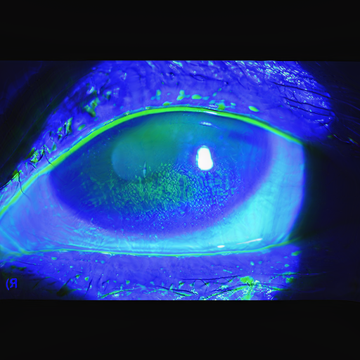
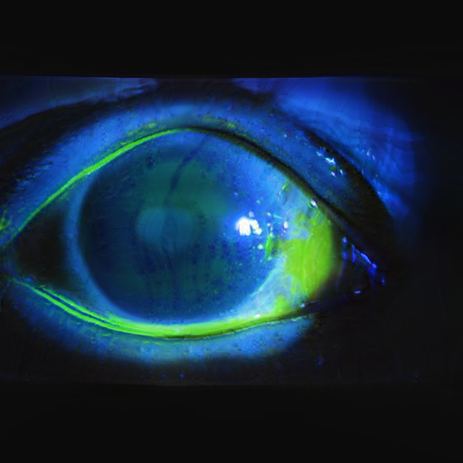

# CTL-GAN · Generate synthetic dry eye images

[](https://doi.org/10.1038/s41598-026-76373-4)
[](https://github.com/bongsang/CTL-GAN/actions/workflows/ci.yml)
[](.python-version)

Generate **512 × 512 synthetic fluorescein-stained anterior segment images**,
conditioned on an SMC or SYSU model and an Oxford grade from 0 to 5.
Choose a model, choose a grade, and generate your own images with reproducible seeds.

```bash
uv run -m maker --hospital smc --grade 3 --num 100
```

**[Paper](https://www.nature.com/articles/s41598-026-76373-4)** ·
**[한국어 안내](docs/README.ko.md)** · **[Model details](docs/models.md)** ·
**[Installation & troubleshooting](docs/installation.md)** · **[Citations](CITATION.bib)**

> **Ready to generate:** [SMC and SYSU model weights](https://github.com/bongsang/CTL-GAN/releases/tag/models-v1)
> download automatically on first use (about 96 MiB per model), then stay cached.
> No training data or bulk image download is required.

## What this repository does

CTL-GAN transfers a StyleGAN3 generator trained on Samsung Medical Center (SMC)
images and adapts it using the Sun Yat-sen University (SYSU) dataset. This repository
provides a small inference interface around **[NVIDIA's StyleGAN3](https://github.com/NVlabs/stylegan3)**.
The underlying GAN algorithm is StyleGAN3, not a new GAN architecture.

| Model option | Meaning | Output |
|---|---|---|
| `--hospital smc` | Generator trained on the SMC dataset | Synthetic SMC-domain images |
| `--hospital sysu` | Generator adapted from SMC weights using SYSU data | Synthetic SYSU-domain images |
| `--grade 0` … `--grade 5` | Requested Oxford grading condition | One-hot class conditioning |

These are **generated images**, not photographs retrieved from a hospital. The
requested grade is a conditioning label, not an independently verified clinical
grade. SYSU refers to the research dataset associated with Sun Yat-sen University,
not a live connection to a hospital.

## Quick start

The tested target is **Linux x86_64 with an NVIDIA GPU**. CPU inference is also
available for a small trial. Windows/WSL2 and macOS notes are in the
[installation guide](docs/installation.md).

1. Install [uv](https://docs.astral.sh/uv/getting-started/installation/) and Git.
2. Clone this repository and install the locked environment:

   ```bash
   git clone --depth 1 https://github.com/bongsang/CTL-GAN.git
   cd CTL-GAN
   uv python install 3.10.21
   uv sync --locked
   uv run -m maker --doctor
   ```

3. Generate images (the selected model downloads automatically on first use):

   ```bash
   # 100 SMC-domain images, Oxford grade 3, seeds 0–99
   uv run -m maker --hospital smc --grade 3 --num 100

   # 10 SYSU-domain images, grade 2, seeds 1000–1009
   uv run -m maker --hospital sysu --grade 2 --num 10 --seed 1000
   ```

The default `--device auto` uses CUDA when available. The default `--impl ref`
uses NVIDIA's reference operators on that device, so **no CUDA toolkit, nvcc, or
C++ compiler is needed for the default inference path**. The first environment
installation downloads PyTorch and its runtime libraries and can take several minutes.

### Find your results

Each command creates a separate directory under `outputs/<hospital>/grade-<n>/`:

```text
outputs/smc/grade-3/<run-id>/
├── smc_grade-3_seed-000000.png
├── smc_grade-3_seed-000001.png
├── …
└── manifest.json
```

Every PNG carries a synthetic-image description. The manifest records the
checkpoint hash, requested grade, seed, truncation, runtime, image hashes, and
completion status. Existing output directories are never overwritten.

## More examples

```bash
# See model availability and all options
uv run -m maker --list-models
uv run -m maker --help

# One image on CPU; useful for trying the interface without an NVIDIA GPU
uv run -m maker --hospital smc --grade 0 --num 1 --device cpu

# A chosen new output directory and a different seed range
uv run -m maker --hospital sysu --grade 4 --num 20 --seed 200 --outdir outputs/my-run

# Explore truncation (changes the sampling distribution)
uv run -m maker --hospital smc --grade 3 --num 4 --trunc 0.7

# Download and verify a model without generating images
uv run -m maker --hospital smc --download-only

# Use a pre-populated cache with networking disabled
uv run -m maker --hospital smc --grade 3 --num 1 --offline --cache-dir /path/to/models
```

`--seed N --num K` uses independent seeds `N` through `N+K-1`. Reusing the same
model, seed, grade, truncation, device and software environment gives repeatable
samples. Different operator implementations or GPU/software versions can change
pixel values; cross-platform bit-for-bit equality is not promised. Defaults use
float32 and truncation 1.0. Lower truncation is an exploratory option, not a claim
of better clinical quality.

For the upstream compiled CUDA operators, use `--impl cuda` only after installing
a CUDA toolkit that matches the PyTorch CUDA runtime and a compatible compiler.
The reference path is the supported starting point; see [compatibility details](docs/installation.md).

## Existing examples

The repository already contains 1,200 synthetic examples (100 per grade per model).
They are retained in [`dataset/smc-gen-ai-images`](dataset/smc-gen-ai-images) and
[`dataset/sysu-gen-ai-images`](dataset/sysu-gen-ai-images). No additional bulk image
dataset is required for generation. Model weights are cached outside Git.

| Existing SMC example · requested grade 3 | Existing SYSU example · requested grade 3 |
|---|---|
|  |  |

These are existing repository examples, not a claim that a fresh execution has
reproduced the historical sample byte for byte. See the validation record in
[models.md](docs/models.md).

## Research scope

This is an **image-generation companion** to the paper. It does not rerun the
classifier experiments or reproduce the paper's quantitative tables. The
publication discusses limitations including possible information leakage from
shared model weights and the lack of formal privacy guarantees. Image synthesis
does not establish anonymization, differential privacy, or suitability for clinical
decisions. Use the outputs for research and evaluation, not diagnosis.

The original clinical photographs are not needed by the generator and are not
included in model downloads. See the paper for dataset access conditions.

## Cite the work

Bongsang Kim, Yeo Kyoung Won, Hokyun Kim, Jiho Cha, Dong Hui Lim, and Jooyoung Jeon.
**Privacy-preserving collaborative transfer learning with generative adversarial
networks (CTL-GAN) for classification of dry eye disease.** *Scientific Reports*
(2026). [doi:10.1038/s41598-026-76373-4](https://doi.org/10.1038/s41598-026-76373-4).
Published 20 October 2026.

Please also cite **Karras et al., Alias-Free Generative Adversarial Networks,
NeurIPS 2021 (StyleGAN3)** when using the generator. Both entries are provided in
[`CITATION.bib`](CITATION.bib), and GitHub's “Cite this repository” uses
[`CITATION.cff`](CITATION.cff).

## Development and license

```bash
uv run -m unittest discover -s tests -v
```

The small CLI tests run without model downloads or a GPU. Actual checkpoint
validation is recorded separately in [docs/validation.md](docs/validation.md).
Training scripts and upstream documentation are retained for reference; the
locked maker environment is validated for inference, not for reproducing training.
Use the [upstream repository](https://github.com/NVlabs/stylegan3) for training tools.

The **NVIDIA Source Code License for StyleGAN3** applies; its use is limited to
non-commercial research/evaluation. Read [`LICENSE.txt`](LICENSE.txt) and
[`THIRD_PARTY_NOTICES.md`](THIRD_PARTY_NOTICES.md). The article's publication
license does not replace the software license.
