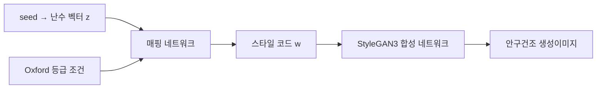

# CTL-GAN 이미지 생성 안내

[English](../README.md) · [논문](https://doi.org/10.1038/s41598-026-76373-4)

SMC 또는 SYSU 모델과 Oxford 등급 0–5를 선택해 **512×512 안구건조 생성이미지**를
만드는 도구입니다. 실제 병원의 환자 사진을 조회하는 기능이 아닙니다.
생성 알고리즘은 [NVIDIA StyleGAN3](https://github.com/NVlabs/stylegan3)를 사용합니다.

> **바로 생성할 수 있습니다.** [SMC·SYSU 모델](https://github.com/bongsang/CTL-GAN/releases/tag/models-v1)은
> 처음 실행할 때 선택한 기관의 파일만 자동으로 내려받습니다(모델당 약 96MiB).
> 이후에는 캐시를 사용합니다. 원본 임상 사진이나 대량 이미지 모음은 필요하지 않습니다.

## 난수 벡터에서 생성이미지까지

[README의 생성 시연 영상](../README.md)은 생성된 안구 이미지가 연속적으로 달라지는
모습을 보여줍니다. 그 배경에 있는 StyleGAN3의 계산 과정은 다음과 같습니다.



seed는 정규분포에서 512개의 수를 뽑는 난수 생성기의 시작값입니다. 이 난수 벡터와
등급 조건을 매핑 네트워크에 넣어 스타일 코드를 만들고, 합성 네트워크가 학습된
가중치로 픽셀을 계산합니다. 공간 표현은 사인파 기반의 Fourier 특징에서 시작해
합성곱·비선형 연산·필터링을 거쳐 최종 RGB 이미지로 변환됩니다. 여기서 noise는
픽셀에 잡음이 섞인 사진이 아니라 **잠재공간의 난수 벡터**를 뜻합니다.

이 구현은 생성 시 데이터세트에서 실제 사진이나 사진 조각을 찾아 붙이지 않으며,
원본 학습 이미지 없이 모델 가중치로 실행됩니다. 다만 학습 자료의 특징을 암기하거나
유사한 결과를 만들 가능성까지 없어지는 것은 아닙니다.

[StyleGAN3 논문과 공식 시연](https://nvlabs.github.io/stylegan3/)은 내부 특징을 연속적인
신호로 다루고 aliasing을 제어해, 이미지의 구조가 움직일 때 세부 무늬가 화면 좌표에
붙어 있는 현상을 줄이는 설계를 설명합니다. 공개 모델은 StyleGAN3-T를 사용합니다.

**영상과 계산 도식의 역할은 구분합니다.** 현재 영상에는 합성된 안구 이미지가
표시되어 있고, 최초 난수 벡터나 각 중간층의 특징 지도는 표시되어 있지 않습니다.
정확한 제작 명령과 입력 경로도 확인되지 않았으므로, 이를 신경망 내부의 각 단계나
확산 모델의 잡음 제거 과정을 직접 촬영한 기록으로 설명하지 않습니다.
[생성 원리·영상 해석·공식 코드 근거](media/README.md#how-stylegan3-creates-an-image)를
함께 읽으면 영상과 생성기의 관계를 이해할 수 있습니다.

## 설치

[uv 설치 안내](https://docs.astral.sh/uv/getting-started/installation/)에 따라 uv와 Git을
준비한 뒤 실행합니다. 검증 환경은 Linux x86_64와 NVIDIA RTX 4090입니다.

```bash
git clone --depth 1 https://github.com/bongsang/CTL-GAN.git
cd CTL-GAN
uv python install 3.10.21
uv sync --locked
uv run -m maker --doctor
```

StyleGAN3와 최신 라이브러리의 호환성 문제를 줄이기 위해 Python 3.10.21,
PyTorch 2.1.2, NumPy 1.26.4를 고정했습니다. 제공된 `uv.lock`을 유지하세요.
기존 `environment.yml`은 과거 upstream 설정이며 이 생성 도구의 설치 경로가 아닙니다.

기본 실행은 NVIDIA의 참조 연산을 사용하므로 **CUDA 컴파일러를 별도로 설치할 필요가
없습니다.** GPU 실행에는 호환되는 NVIDIA 드라이버가 필요합니다. CPU도 선택할 수 있습니다.

## 이미지 생성

아래 명령을 실행하면 가중치를 자동으로 내려받고 체크섬을 검증한 뒤 생성합니다.

```bash
# SMC 모델, Oxford grade 3, 100장, seed 0–99
uv run -m maker --hospital smc --grade 3 --num 100

# SYSU 모델, Oxford grade 2, 10장, seed 1000–1009
uv run -m maker --hospital sysu --grade 2 --num 10 --seed 1000

# GPU 없이 1장 생성
uv run -m maker --hospital smc --grade 3 --num 1 --device cpu

# 결과 위치를 직접 지정: 아직 존재하지 않는 폴더를 사용합니다.
uv run -m maker --hospital smc --grade 3 --num 5 --outdir outputs/my-first-run
```

기본 결과 위치는 `outputs/기관/grade-등급/실행번호/`입니다. PNG 파일과
`manifest.json`이 함께 저장됩니다. manifest에는 모델 체크섬, seed, 요청 등급,
소프트웨어 버전, 생성 파일 체크섬과 완료 상태가 남습니다. 이전 결과는 덮어쓰지 않습니다.

- `--hospital smc`: 삼성서울병원 자료로 학습한 생성 모델입니다.
- `--hospital sysu`: SMC 가중치에서 SYSU 자료를 이용해 미세조정한 생성 모델입니다.
- `--grade`: 생성 조건으로 지정하는 Oxford 등급이며 개별 결과의 임상 판독 확정값이 아닙니다.
- `--num`: 1–10,000장입니다. 순서대로 한 장씩 생성합니다.
- `--seed`: 시작 seed입니다. 같은 모델·환경·옵션에서 재현 가능한 샘플을 만듭니다.
- `--trunc`: 기본값 1.0입니다. 변경하면 샘플링 분포가 달라지며 임상 품질 향상을 보장하지 않습니다.

전체 옵션은 `uv run -m maker --help`, 환경 정보는 `uv run -m maker --doctor`로
확인합니다. 자세한 호환성과 오류 해결은 [설치 안내](installation.md)를 참조하세요.

## 연구 범위와 인용

이 도구는 논문을 읽은 독자가 직접 생성이미지를 만들어 보는 추론 도구입니다.
분류실험의 재학습이나 논문 성능표의 전체 재현을 수행하지 않습니다. 생성이미지와 모델
가중치의 공개가 환자 정보 보호를 수학적으로 보장한다는 의미도 아닙니다.
연구·평가 목적으로 사용하며 진단용으로 사용하지 않습니다.

**Kim, B., Won, Y. K., Kim, H., Cha, J., Lim, D. H., & Jeon, J. (2026).**
Privacy-preserving collaborative transfer learning with generative adversarial networks
(CTL-GAN) for classification of dry eye disease. *Scientific Reports*.
[https://doi.org/10.1038/s41598-026-76373-4](https://doi.org/10.1038/s41598-026-76373-4)

생성 알고리즘을 사용한 연구에는 **Karras et al., Alias-Free Generative Adversarial
Networks, NeurIPS 2021**도 인용하세요. [BibTeX](../CITATION.bib)와
[GitHub 인용 정보](../CITATION.cff)를 제공합니다.

소프트웨어에는 [NVIDIA StyleGAN3 라이선스](../LICENSE.txt)의 비상업적 연구·평가
이용 조건이 적용됩니다. 논문의 출판 라이선스와 구분합니다.
