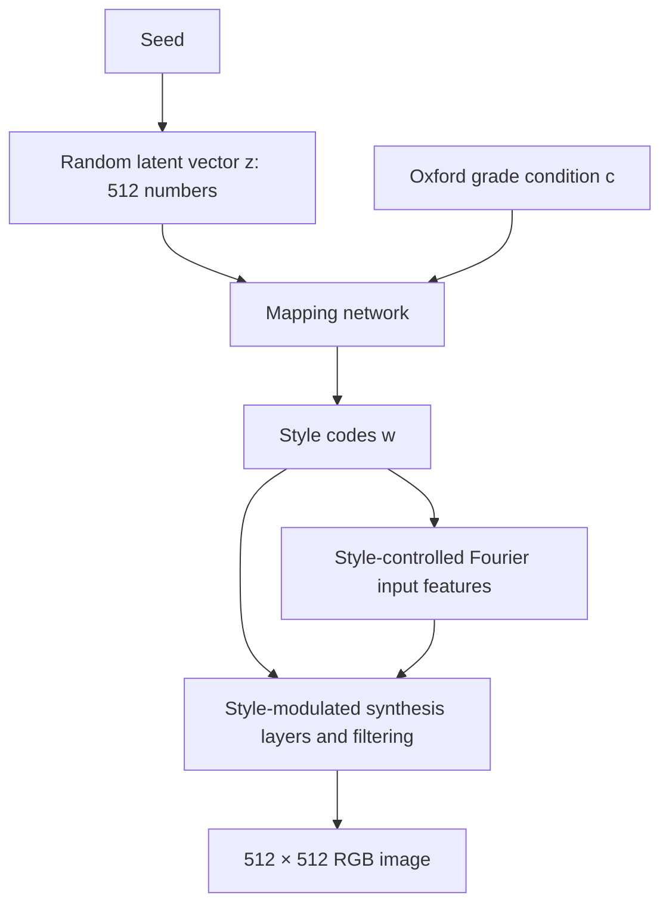

# Generation demonstration video

[Watch or download the original MP4](generating.mp4)

The author supplied this short visualization of synthetic eye images for the
CTL-GAN repository introduction. The original video is preserved without edits.
It provides a visual introduction to the generator’s synthetic eye images.

## How StyleGAN3 creates an image

A useful way to read this demonstration is to connect the changing images to the
learned function that produces them. In CTL-GAN's maker, that function is a
conditional StyleGAN3 generator: **image = G(z, c)**, where `z` is a random latent
vector, `c` is the requested Oxford grade, and the hospital option selects the
learned generator weights.

1. **Sample random numbers.** A seed initializes a pseudorandom number generator.
   The maker draws 512 normally distributed numbers to form `z`. The seed
   identifies a reproducible draw; it is not an index into a collection of patient
   photographs. Here, “noise” means a latent vector, not a noisy RGB photograph.
2. **Map the input to styles.** The mapping network combines the normalized
   latent vector with an embedding of the grade condition and produces style
   codes `w`. These codes control operations in the synthesis network.
3. **Synthesize spatial structure.** StyleGAN3 starts its spatial representation
   with Fourier features—patterns built from sinusoidal signals. Learned,
   style-modulated convolutions, nonlinearities and filtering transform those
   features through successive layers into an RGB image. Intermediate features
   are numerical arrays; they are not necessarily recognizable partial eye images.
4. **Save the output.** The maker converts the generator output to a 512×512 RGB
   PNG. The requested grade remains a conditioning label, not a confirmed clinical
   interpretation of that PNG.

This pathway is visible in the repository's
[`synthesize` function](../../maker/runtime.py) and the vendored
[`MappingNetwork`, `SynthesisInput`, `SynthesisNetwork` and `Generator` classes](../../training/networks_stylegan3.py).
It also follows the [official NVIDIA generator implementation](https://github.com/NVlabs/stylegan3/blob/c233a919a6faee6e36a316ddd4eddababad1adf9/training/networks_stylegan3.py).

### What learning contributes

During training, the generator and discriminator are optimized using training
images. The resulting weights encode learned statistical regularities that can
be used to synthesize images. At inference, this implementation loads those
weights and computes pixels from `z` and the condition; it does not retrieve
training photographs or paste their patches together. That describes this
StyleGAN3 pipeline, not every system marketed as generative AI.

The absence of an image-retrieval step is **not evidence that memorization is
impossible**. A generator can still reproduce training-specific details. The
[CTL-GAN paper](https://doi.org/10.1038/s41598-026-76373-4) discusses the limits of
its privacy assessment; this animation is not a privacy test.

### Why the StyleGAN3 design matters

Karras et al.'s [*Alias-Free Generative Adversarial Networks* (NeurIPS 2021)](https://nvlabs.github.io/stylegan3/)
treats internal feature maps as samples of continuous signals and controls
aliasing with carefully designed filtering. This addresses “texture sticking,”
where fine details remain tied to screen coordinates as larger structures move.
The official project illustrates the effect with latent-space animations.
Our released checkpoints use **StyleGAN3-T**, the translation-equivariant
configuration. The eye-image clip is an illustration of generated appearances,
not a measurement of equivariance or evidence of anatomical correctness.

### What this particular clip shows

The supplied eight-second clip presents a grid of synthesized eye images that
change over time. It does not display the initial latent vectors, label the
intermediate feature maps, or identify the inputs used for each frame. Its exact
rendering command and latent trajectory have not been recovered. The explanation
above describes the verified maker/StyleGAN3 computation; it is not a recovered
execution trace of this historical MP4.

For comparison, NVIDIA's official [`gen_video.py`](https://github.com/NVlabs/stylegan3/blob/c233a919a6faee6e36a316ddd4eddababad1adf9/gen_video.py)
creates animations by interpolating style codes and running the synthesis network
for every frame. In such an animation, each frame is a complete generated image;
time traverses the latent space rather than the layers of one forward pass.
Visual similarity alone does not establish that this clip used that exact script.
StyleGAN3's generation pathway should also be distinguished from iterative
pixel-noise removal in a diffusion model.

The educational value of the clip is that viewers can see changing synthetic
appearances while the diagram explains how a learned generator computes images
from numerical inputs. Directly visualizing internal activations would require a
separately recorded and labeled layer-by-layer demonstration.

## Permission

**Copyright © Bongsang Kim.**

You may use and share this demonstration video, including in scholarly
publications, provided that you credit **Bongsang Kim** and cite the CTL-GAN paper:

Kim, B., Won, Y. K., Kim, H., Cha, J., Lim, D. H., & Jeon, J. (2026).
*Privacy-preserving collaborative transfer learning with generative adversarial
networks (CTL-GAN) for classification of dry eye disease.* Scientific Reports.
[https://doi.org/10.1038/s41598-026-76373-4](https://doi.org/10.1038/s41598-026-76373-4)

Suggested credit: “CTL-GAN generation demonstration video © Bongsang Kim;
Kim et al., Scientific Reports (2026), doi:10.1038/s41598-026-76373-4.”

This permission applies to **this video**. It does not replace the
[NVIDIA StyleGAN3 license](../../LICENSE.txt) governing the software and model
use. The copyright and reuse terms above were supplied by the author on
2026-10-21.

## File provenance

- Source: author-provided `generating.mp4`, received from the author's local archive
  on 2026-10-21. This is the registration date, not a claim about the creation date.
- Original filename: `generating.mp4`.
- Duration: approximately 8.04 seconds.
- Video: H.264, 512 × 256, 24 frames per second; original AAC audio retained.
- Size: 2,050,613 bytes.
- SHA-256: `17d27eeef70a77d81ee060d4255f8174c6c05a98a6dc2ace0d3fdb3959d8ccaa`.
- The GitHub-hosted player in the main README uses an uploaded copy of this file.
