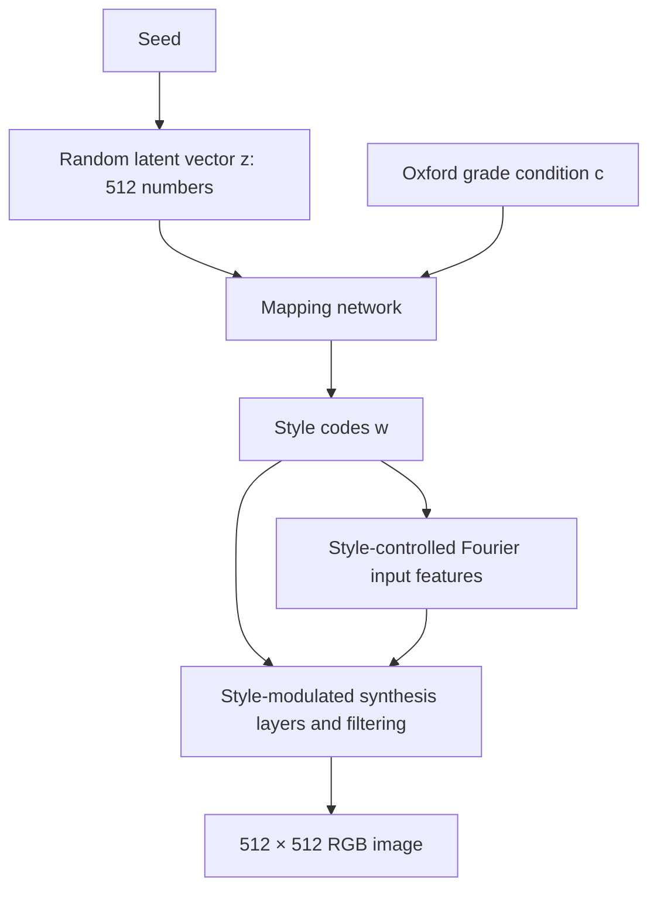

# Generation demonstration video

[Watch or download the original MP4](generating.mp4)

This eight-second demonstration shows a grid of synthetic eye images changing
over time. The diagram below describes the computation that produces an
individual image.

## How StyleGAN3 creates an image

CTL-GAN uses a conditional StyleGAN3 generator: **image = G(z, c)**, where `z`
is a random latent vector, `c` is the requested Oxford grade, and the hospital option selects the
learned generator weights.

1. **Sample random numbers.** A seed initializes a pseudorandom number generator.
   The maker draws 512 normally distributed numbers to form `z`. The seed
   identifies a reproducible draw; it is not an index into a collection of patient
   photographs. Here, “noise” means a latent vector, not a noisy RGB photograph.
2. **Map the input to styles.** The mapping network combines the normalized
   latent vector with an embedding of the grade condition and produces style
   codes `w`. These codes control operations in the synthesis network.
3. **Synthesize spatial structure.** StyleGAN3 starts its spatial representation
   with Fourier features—patterns built from sinusoidal signals. Learned,
   style-modulated convolutions, nonlinearities and filtering transform those
   features through successive layers into an RGB image. Intermediate features
   are numerical arrays; they are not necessarily recognizable partial eye images.
4. **Save the output.** The maker converts the generator output to a 512×512 RGB
   PNG. The requested grade remains a conditioning label, not a confirmed clinical
   interpretation of that PNG.

This pathway is visible in the repository's
[`synthesize` function](../../maker/runtime.py) and the vendored
[`MappingNetwork`, `SynthesisInput`, `SynthesisNetwork` and `Generator` classes](../../training/networks_stylegan3.py).
It also follows the [official NVIDIA generator implementation](https://github.com/NVlabs/stylegan3/blob/c233a919a6faee6e36a316ddd4eddababad1adf9/training/networks_stylegan3.py).

### What learning contributes

During training, the generator and discriminator are optimized using training
images. The resulting weights encode learned statistical regularities that can
be used to synthesize images. At inference, this implementation loads those
weights and computes pixels from `z` and the condition; it does not retrieve
training photographs or paste their patches together.

Learned generators can retain training-specific details. The
[CTL-GAN paper](https://doi.org/10.1038/s41598-026-76373-4) discusses the limits of
its privacy assessment; image synthesis alone does not establish a formal privacy
guarantee.

### Why the StyleGAN3 design matters

Karras et al.'s [*Alias-Free Generative Adversarial Networks* (NeurIPS 2021)](https://nvlabs.github.io/stylegan3/)
treats internal feature maps as samples of continuous signals and controls
aliasing with carefully designed filtering. This addresses “texture sticking,”
where fine details remain tied to screen coordinates as larger structures move.
The official project illustrates the effect with latent-space animations.
Our released checkpoints use **StyleGAN3-T**, the translation-equivariant
configuration. The eye-image clip is an illustration of generated appearances,
not a measurement of equivariance or evidence of anatomical correctness.

### Interpreting the animation

The video displays generated outputs. It does not show intermediate feature maps
or the progression of one image through the network. The original rendering
parameters and latent trajectory are undocumented.

NVIDIA's official [`gen_video.py`](https://github.com/NVlabs/stylegan3/blob/c233a919a6faee6e36a316ddd4eddababad1adf9/gen_video.py)
illustrates latent-space animation by interpolating style codes and evaluating the
synthesis network for each frame. Each frame is a complete generated image.
StyleGAN3 produces images through a forward pass, rather than the iterative
pixel-noise denoising sequence used in diffusion sampling.

## Permission

**Copyright © Bongsang Kim.**

You may use and share this demonstration video, including in scholarly
publications, provided that you credit **Bongsang Kim** and cite the CTL-GAN paper:

Kim, B., Won, Y. K., Kim, H., Cha, J., Lim, D. H., & Jeon, J. (2026).
*Privacy-preserving collaborative transfer learning with generative adversarial
networks (CTL-GAN) for classification of dry eye disease.* Scientific Reports.
[https://doi.org/10.1038/s41598-026-76373-4](https://doi.org/10.1038/s41598-026-76373-4)

Attribution: “CTL-GAN generation demonstration video © Bongsang Kim;
Kim et al., Scientific Reports (2026), doi:10.1038/s41598-026-76373-4.”

This permission applies to **this video**. It does not replace the
[NVIDIA StyleGAN3 license](../../LICENSE.txt) governing the software and model
use.

## Video specifications

- Original filename: `generating.mp4`.
- Duration: approximately 8.04 seconds.
- Video: H.264, 512 × 256, 24 frames per second; original AAC audio retained.
- Size: 2,050,613 bytes.
- SHA-256: `17d27eeef70a77d81ee060d4255f8174c6c05a98a6dc2ace0d3fdb3959d8ccaa`.
- The GitHub-hosted player in the main README uses an uploaded copy of this file.
