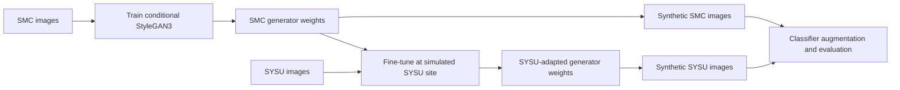

# CTL-GAN and the image generator

CTL-GAN applies collaborative transfer learning to StyleGAN3. In the
[published study](https://doi.org/10.1038/s41598-026-76373-4), generator weights
trained on Samsung Medical Center (SMC) images were transferred to a simulated
site represented by the Sun Yat-sen University (SYSU) dataset and fine-tuned on
local images. The transfer used model weights without exchanging raw images.
Synthetic images were then used for classifier augmentation.

## Research workflow



This is a conceptual summary of the published workflow. The transfer arrow
represents generator weights; each dataset is used at its respective training
stage. The repository's `maker` command runs inference from released generators.
It does not execute training, inter-site transfer, or classifier evaluation.

## Generate images

`--hospital smc` selects the source generator; `--hospital sysu` selects the
adapted generator. Both accept an Oxford grade and a seeded latent input.

```bash
uv run -m maker --hospital smc --grade 3 --count 100
uv run -m maker --hospital sysu --grade 3 --count 100
```

The [StyleGAN3 generation diagram](media/README.md#how-stylegan3-creates-an-image)
describes the mapping and synthesis networks inside either generator.
[Seeds and truncation](sampling.md) explains how sampling controls the output.
